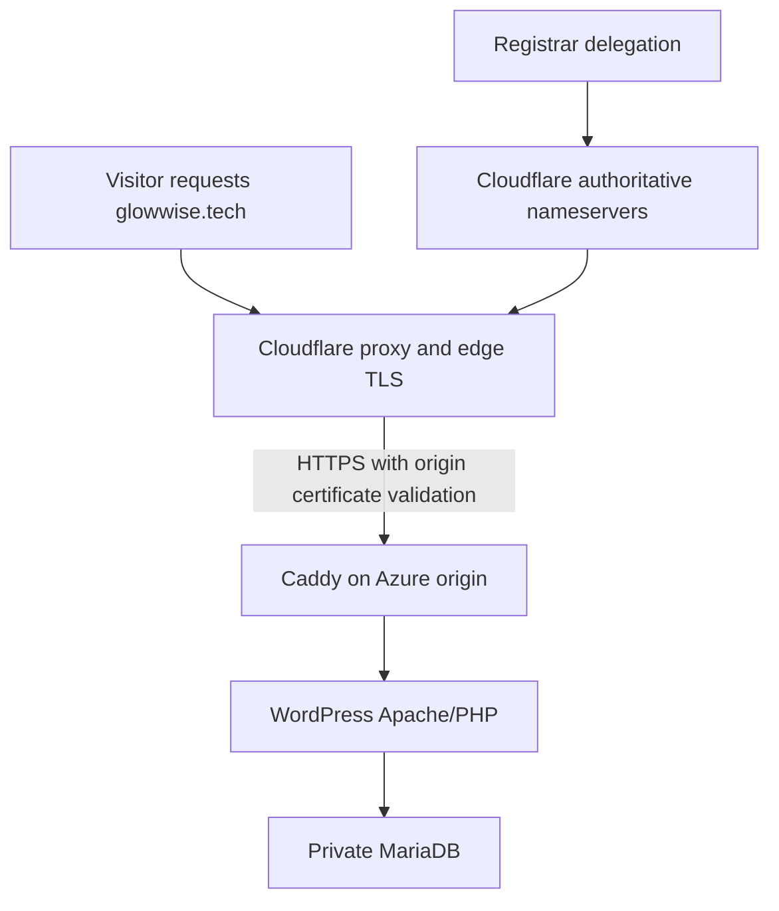
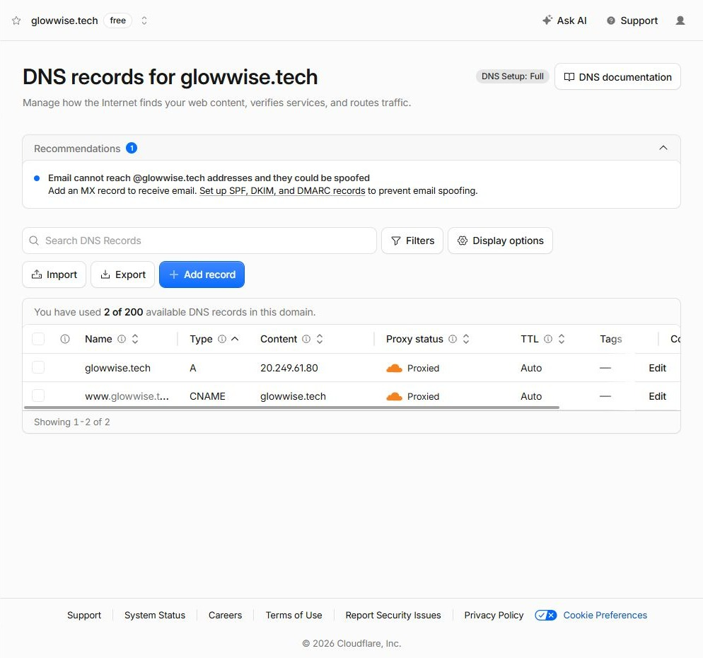
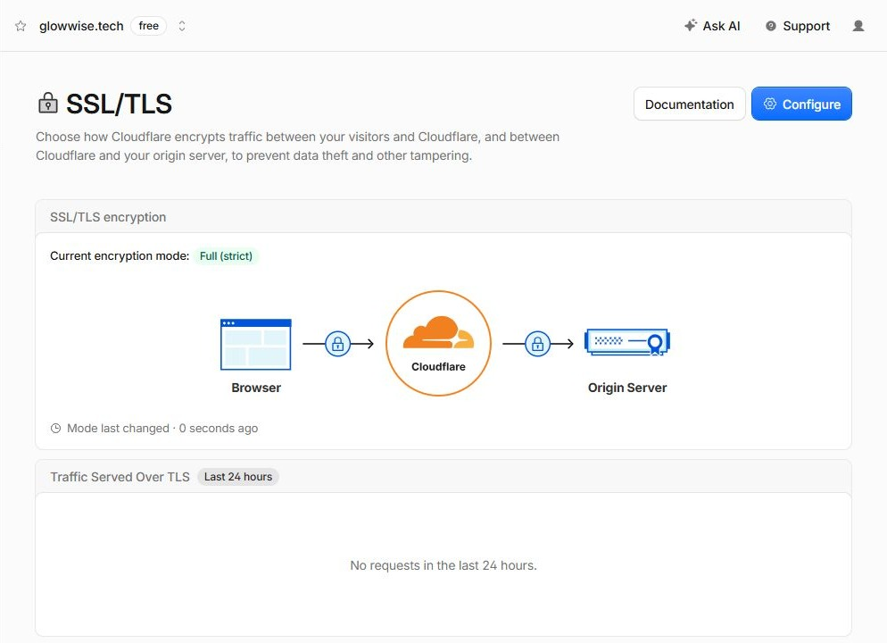
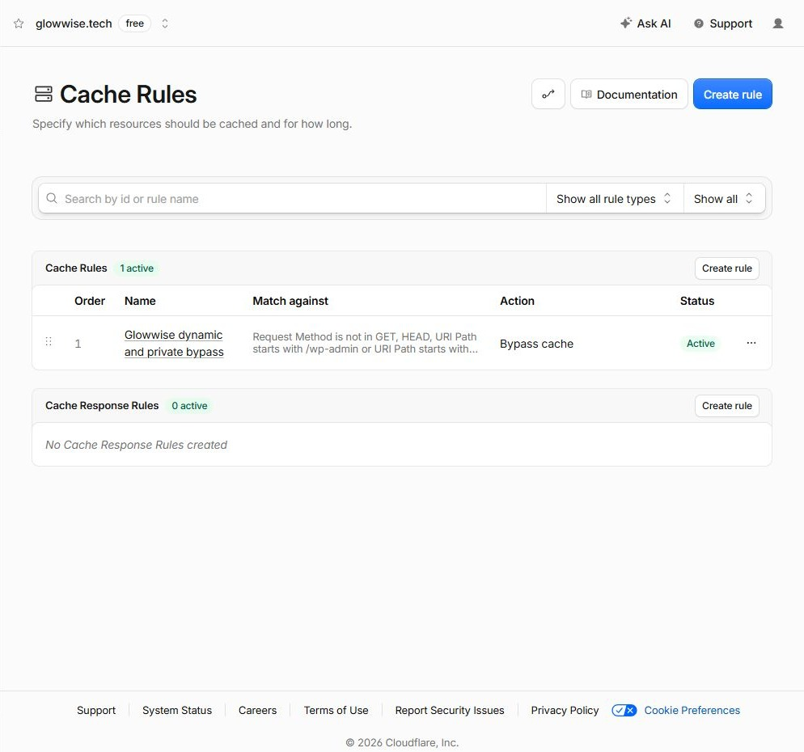

# Glowwise — Domain, DNS & Cloudflare Configuration

> **Current release — 10 October 2026:** Glowwise is live with 40 researched product families, 55 variants and seven founder-credited guides. All 40 families have photographs; 54/55 exact variants are pictured. The Minimalist Maleic Shampoo 100 ml pack remains a labelled fallback. Brand photographs have source attribution and disclosed demo-use status; reuse permission has not been independently verified. Published revision: `c55b1bd`. See the [release handoff](../Implementation/DEMO_MEDIA_RELEASE.md) and [current report](MILESTONE_I_SUBMISSION_REPORT.md). Research estimates and older evidence retain their original dates.

**Milestone 1 · Criterion 7 · 2 marks**  
**Documentation and fresh verification:** 10 October 2026, IST  
**Live website:** [glowwise.tech](https://glowwise.tech/)  
**Status:** Implemented; DNS, public delivery, trusted HTTPS and selected cache behaviour independently rechecked. Historical dashboard captures retain their original dates.

**Product authority:** [Source of Truth](../../GLOWWISE_SOURCE_OF_TRUTH.md)  
**Implementation facts:** [Deployment facts](../Implementation/DEPLOYMENT_FACTS.md) · [Operations](../Deployment/OPERATIONS.md)  
**Criterion evidence:** [Evidence index](<../References/Milestone 1/07 Domain DNS Cloudflare/Evidence_Index.md>)

## 1. Assessment requirement and delivered result

The handbook requires a registered custom domain, Cloudflare nameservers and DNS, CDN delivery, Full/Strict SSL, minification and caching rules, together with DNS-propagation verification. Its Excellent descriptor requires correct configuration, clean website resolution and supporting evidence.

Glowwise uses the registered domain **`glowwise.tech`**, Cloudflare's Free plan and an Azure origin. Visitors reach the site through Cloudflare; Caddy provides a valid Let's Encrypt certificate at the origin and forwards requests to WordPress. Static assets can be served from the CDN cache, while dynamic and private requests are deliberately excluded.

| Requirement | Glowwise implementation | Evidence |
|---|---|---|
| Custom domain | Existing `glowwise.tech` registration through Namify / .Tech Domains / Radix; registration interface is owner-confirmed. | Source of Truth; DNS control and active public website. Registrar receipt not reproduced. |
| Nameservers | `angela.ns.cloudflare.com` and `trace.ns.cloudflare.com`. | E01: fresh authoritative and public-resolver observations. |
| DNS records | Proxied apex A record to `20.249.61.80`; proxied `www` CNAME to `glowwise.tech`. | E03: actual DNS screenshot; E01: resulting public answers. |
| CDN | Cloudflare serves public requests and caches eligible static assets. | E02: `Server: cloudflare`, `CF-Ray`, stylesheet `MISS` → `HIT`. |
| Full/Strict SSL | Full (strict) selected; independently trusted edge and origin certificates. | E04: selected-mode screenshot; E02: fresh TLS validation. |
| Minification | esbuild bundles/minifies CSS and JavaScript on the VM. | E07: build source and actual VM output; discontinued Cloudflare feature explained below. |
| Caching rules | Active dynamic/private bypass; Standard cache level; browser TTL respects origin headers. | E05/E06: settings/rule proof; E02/E08: response behaviour. |
| DNS propagation | Both authoritative servers and Cloudflare/Google recursive resolvers return the assigned nameservers and functioning proxied records. | E01: 12 dated DNS observations. |

The document demonstrates the work against the criterion; it does not self-award marks.

## 2. Domain choice, registration and responsibilities

`glowwise.tech` provides one stable, branded address for the editorial website, product catalog and discovery tools. It preserves the approved Glowwise name without hyphens or numbers. The `.tech` extension is the registered choice; no direct ranking advantage is attributed to it.

The domain was already registered by the owner through Namify / .Tech Domains / Radix. No replacement domain or GitHub Student domain redemption was used for this deployment. The registrar allows nameserver changes, and the owner replaced the previous Orderbox delegation with the assigned Cloudflare pair.

Responsibilities are distinct:

| Layer | Responsibility |
|---|---|
| Registrar | Registration, ownership administration, renewal and parent-zone delegation. |
| Cloudflare | Authoritative DNS, public reverse proxy/CDN, edge TLS and cache rules. |
| Azure | Origin VM and associated network/storage resources. |
| Caddy | Origin HTTPS, canonical redirects, compression and response cache headers. |
| WordPress | Site content, product tools and application responses. |

**Registration evidence boundary:** the registrar identity is supported by the owner's explicit decision and Source of Truth. Public DNS and website operation prove functioning delegation and delivery, not the purchase price, registration date, renewal date or account-holder identity. Those details are not invented. A redacted registrar domain-summary or receipt can supplement the submission if documentary purchase evidence is requested.

## 3. DNS architecture and actual records



### Authoritative delegation

```text
angela.ns.cloudflare.com
trace.ns.cloudflare.com
```

The original Pending/Orderbox observations in the readiness record are historical. The deployed configuration and fresh observations show the Cloudflare delegation in use.

### Website-routing records

| Type | Name | Configured destination | Proxy | TTL |
|---|---|---|---|---|
| A | `glowwise.tech` (`@`) | Azure origin `20.249.61.80` | Proxied | Auto |
| CNAME | `www` | `glowwise.tech` | Proxied | Auto |

The DNS screenshot below was captured on **9 October 2026 at 10:49:22 UTC / 16:19:22 IST**. It shows the actual website-routing records and proxy status. A Google verification TXT record was added later; this image is not presented as the complete latest zone inventory.



*Figure 1. Reviewed redacted dashboard capture; private account/sidebar information is excluded.*

Proxied records return Cloudflare addresses to public clients rather than the configured origin address. Therefore, seeing different A answers from `20.249.61.80` is expected. This also explains why a proxied `www` CNAME can resolve publicly to edge A records. [Cloudflare proxy-status documentation](https://developers.cloudflare.com/dns/proxy-status/).

The site uses **`https://glowwise.tech`** as its canonical origin. Fresh observations show HTTP apex, HTTP `www` and HTTPS `www` each returning **301** directly to that HTTPS apex, preserving the inspected path and query string. This reduces avoidable host/protocol duplicates; it does not itself prove every page's SEO canonical tag.

## 4. DNS-propagation verification

Fresh collection began on **10 October 2026 at 05:41:23 UTC / 11:11:23 IST**. Explicit queries were made using `Resolve-DnsName -DnsOnly` against both authoritative servers and two independent recursive services. Each resolver was queried for apex NS, apex A and `www` A records.

| Resolver | Apex NS answer | Apex and `www` A answers | Result |
|---|---|---|---|
| `angela.ns.cloudflare.com` | Assigned angela/trace pair | `104.21.95.116`, `172.67.144.188` | Successful |
| `trace.ns.cloudflare.com` | Assigned angela/trace pair | Same edge-address set | Successful |
| Cloudflare `1.1.1.1` | Assigned angela/trace pair | Same edge-address set | Successful |
| Google `8.8.8.8` | Assigned angela/trace pair | Same edge-address set | Successful |

Answer order varied, which does not change the resulting address set. The complete observations, returned TTLs and error fields are preserved in [E01 — fresh DNS record](<../References/Milestone 1/07 Domain DNS Cloudflare/2026-10-10_DNS_Refresh.json>).

Representative reproducible commands:

```powershell
Resolve-DnsName glowwise.tech -Type NS -Server 1.1.1.1 -DnsOnly
Resolve-DnsName glowwise.tech -Type NS -Server 8.8.8.8 -DnsOnly
Resolve-DnsName glowwise.tech -Type A -Server angela.ns.cloudflare.com -DnsOnly
Resolve-DnsName www.glowwise.tech -Type A -Server trace.ns.cloudflare.com -DnsOnly
```

**Interpretation:** the configured delegation and website records are available from the observed authoritative and recursive services. This is scoped propagation evidence, not a claim that every ISP or geographic location was tested. The JSON contains actual resolver output; no global propagation screenshot was reconstructed.

## 5. HTTPS: edge encryption and validated origin encryption

Cloudflare is configured to **Full (strict)**. This encrypts the connection to the origin and validates its certificate. Cloudflare requires an unexpired certificate issued by an accepted authority and matching the target hostname. [Cloudflare Full (strict) requirements](https://developers.cloudflare.com/ssl/origin-configuration/ssl-modes/full-strict/).



*Figure 2. Actual selected encryption mode, captured 9 October 2026 at 03:44:39 UTC / 09:14:39 IST. The early traffic panel is historical and is not used as current traffic evidence.*

Fresh TLS collection began on **10 October at 05:41:48 UTC / 11:11:48 IST**. Connections used normal system certificate validation and the hostname `glowwise.tech`, including when connecting directly to the known origin. No certificate-verification bypass was used.

| Connection | Observed protocol | Issuer | Hostname coverage | Expiry, UTC | Trust result |
|---|---|---|---|---|---|
| Visitor → Cloudflare edge | TLS 1.3 | Let's Encrypt, YE2 | `glowwise.tech`, `*.glowwise.tech` | 7 January 2027, 02:03:20 | Validated |
| Direct origin, with apex SNI | TLS 1.3 | Let's Encrypt, YE1 | `glowwise.tech` | 7 January 2027, 03:07:36 | Validated |

These are distinct certificates and connections. Successful origin verification complements the selected-mode screenshot; it does not independently read the current Cloudflare dashboard setting. The fresh homepage response was **HTTP 200** through Cloudflare, without the former preview lock.

At the origin, the [Caddy configuration](../../deploy/stack/Caddyfile) explicitly selects the Let's Encrypt ACME directory. Certificate storage persists in the deployment stack. Caddy manages automatic renewal; **Certbot is not installed or claimed**. [Caddy automatic HTTPS](https://caddyserver.com/docs/automatic-https).

No elapsed renewal cycle has been observed. Renewal requires the running/reachable origin and appropriate validation access. The operational runbook addresses this dependency. Historical dashboard records also show minimum TLS 1.2, TLS 1.3 enabled and HSTS/preload not enabled; those settings were not freshly changed for this documentation pass.

## 6. CDN and deliberate caching rules

Cloudflare proxying is enabled for both website records. Fresh responses contain `Server: cloudflare` and `CF-Ray`; repeat stylesheet requests demonstrate actual CDN cache delivery.

Cloudflare's observed defaults are **Standard** cache level and **Respect Existing Headers** for browser caching. The active rule, **“Glowwise dynamic and private bypass,”** uses the **Bypass cache** action. The exact expression is preserved in [E05's expression record](../References/Deployment/2026-10-09_Cloudflare_Cache_Expression.json).



*Figure 3. Actual active-rule capture, 9 October 2026 at 04:07:09 UTC / 09:37:09 IST. One active Cache Rule; no separate Cache Response Rule claimed.*

### Cache policy and reason

| Response/request class | Policy | Reason |
|---|---|---|
| Reviewed content-hashed theme CSS/JS | Public, one-year `max-age`, `immutable` | A changed build receives a new filename. |
| Other approved theme static assets | Public, one-day `max-age` | Allows reuse while retaining a shorter update window. |
| HTML and ordinary application routes | `private, no-store`; bypass/dynamic | Avoids stale or inappropriate application responses. |
| Admin, login, REST and contact routes | Bypass; private/no-store responses | Protects administrative, form and API behaviour. |
| Writes, Authorization headers, relevant session/form cookies, query strings | Bypass | Avoids accidental caching of changing/session-sensitive state. |
| Other non-static paths | Bypass | Conservative eligibility boundary. |

Cloudflare's rule permits consideration of static extensions, while Caddy's public cache-header allowlist is narrower: reviewed files beneath the Glowwise theme asset directory. An extension alone does not establish that a response is safe to cache. Cloudflare does not cache HTML/JSON by default; the implementation adds explicit exclusions and origin headers. [Cloudflare default cache behaviour](https://developers.cloudflare.com/cache/concepts/default-cache-behavior/).

### Actual response observations

| Fresh request | Status | Observed caching |
|---|---|---|
| Homepage | 200 | `DYNAMIC`; `private, no-store`. |
| WordPress login | 200 | `DYNAMIC`; private/no-store. |
| Contact page | 200 | `DYNAMIC`; private/no-store. |
| Search query | 200 | `DYNAMIC`; `private, no-store`. |
| `site.T62MBYRK.css`, first request | 200 | `MISS`; public one-year immutable header. |
| Same stylesheet, repeat request | 200 | `HIT`; `Age: 0`. |
| `visuals.VDNVUM7X.css`, repeated requests | 200 | `HIT`; increasing Age 5283 → 5284. |

See [E02 — HTTP/TLS readback](<../References/Milestone 1/07 Domain DNS Cloudflare/2026-10-10_HTTP_TLS_Refresh.json>). The actual catalog route `/wp-json/glowwise/v1/products` was additionally observed; an auxiliary probe to unregistered `/catalog` returned 404 and is identified in the raw record rather than described as a failed catalog.

The earlier editorial [cache/redirect record](../References/Deployment/Editorial/cache-redirects.json), captured at **05:16:36 UTC / 10:46:36 IST on 10 October**, contains **38 checks, all passing**, including public static-asset HITs, compressed JavaScript, and dynamic/private exclusions. This is separately dated supporting evidence, not a new rerun of the whole suite.

WP Super Cache is installed, but full-page caching is deliberately off in the documented release. CDN asset caching is demonstrably active. `DYNAMIC` on login/contact is correct behaviour, not evidence that the CDN is disabled. This strategy prioritises safe application behaviour; it does not claim every response is cached or quantify a speed improvement from caching alone.

## 7. Minification and the retired Cloudflare setting

The marking scheme mentions minification. **Cloudflare Auto Minify was deprecated; its API deprecation date is 5 August 2024.** It is not represented as enabled. [Cloudflare official deprecation record](https://developers.cloudflare.com/fundamentals/api/reference/deprecations/#2024-08-05).

Glowwise fulfils the asset-minification objective through its reproducible build:

1. CSS/JavaScript source resides under `theme/glowwise/assets/src/`.
2. [The build script](../../tooling/build-assets.mjs) uses esbuild with `bundle: true` and `minify: true`.
3. Content-hashed outputs and a manifest are produced beneath `assets/dist/`.
4. Deployed assets receive suitable public cache headers and are delivered through Cloudflare.

The preserved [actual VM build output](../References/Deployment/2026-10-09_Stage3_Build_Health.txt) records a completed build and esbuild **0.28.2**. Its small verification fixtures reduced JavaScript **46 → 43 bytes** and CSS **55 → 31 bytes**. Those numbers describe fixtures, not total website savings. Fresh delivery of hashed CSS and earlier compressed JS observations support the deployed pipeline. [esbuild minification documentation](https://esbuild.github.io/api/#minify).

Build-time minification and transport compression perform different jobs. The fresh readback requested identity encoding, so its absent compression header does not contradict the separately recorded gzip observations. No Cloudflare HTML-minification switch or site-wide savings percentage is claimed.

## 8. Verification boundaries and maintenance

- **Evidence dates:** dashboard configuration is captured on 9 October; resolver, HTTPS and selected response observations were refreshed on 10 October. No authenticated dashboard reread was performed during this documentation pass.
- **Registration:** registrar details are owner-confirmed; a purchase/renewal receipt remains optional supplementary proof if requested.
- **Propagation:** four resolver endpoints were checked; worldwide instantaneous consistency is not claimed.
- **Certificates:** current trust, hostname and expiry were verified; an actual renewal event was not observed.
- **Availability:** this is a dated live result, not a promise of indefinite uptime. The hosting cost guard retains a finite lease ending **16 October 2026 at 09:31:49 IST** in the operational records. Confirm hosting availability before assessment and resolve lifecycle changes within the owner's total budget.
- **Security:** bypass rules and selected response checks support the stated cache boundary; they are not a comprehensive security certification. Cloudflare proxying is not claimed to make the documented origin undiscoverable.

This pass created documentation and read-only evidence. It did not change DNS, TLS settings, cache rules, server configuration, hosting resources or application code, and did not commit or push changes.

## 9. Criterion conclusion

Glowwise has a functioning custom-domain delivery path with Cloudflare delegation and proxied website records, Full (strict) configuration, a valid Let's Encrypt origin certificate, public HTTPS delivery, canonical redirects, documented build-time minification and an active cache policy. Fresh authoritative/recursive DNS results and actual CDN HIT observations substantiate the implementation. The evidence index ties every assessed claim to its screenshot, configuration or dated observation, while preserving the registration and renewal evidence boundaries.

## 10. Sources and evidence

Assessment authority: `Reference/Mini-Project Handbook.docx`, Milestone I criterion 7 and its Excellent performance descriptor. Product authority and implementation records are linked above.

Technical references checked **10 October 2026**:

1. [Cloudflare — DNS proxy status](https://developers.cloudflare.com/dns/proxy-status/).
2. [Cloudflare — Full (strict) requirements](https://developers.cloudflare.com/ssl/origin-configuration/ssl-modes/full-strict/).
3. [Cloudflare — Default cache behaviour](https://developers.cloudflare.com/cache/concepts/default-cache-behavior/).
4. [Cloudflare — Auto Minify deprecation](https://developers.cloudflare.com/fundamentals/api/reference/deprecations/#2024-08-05).
5. [Caddy — Automatic HTTPS](https://caddyserver.com/docs/automatic-https).
6. [esbuild — Minification](https://esbuild.github.io/api/#minify).

Provider documentation explains the mechanisms; Glowwise's own dated evidence proves the implementation. See the [criterion evidence index](<../References/Milestone 1/07 Domain DNS Cloudflare/Evidence_Index.md>) for the complete record.
