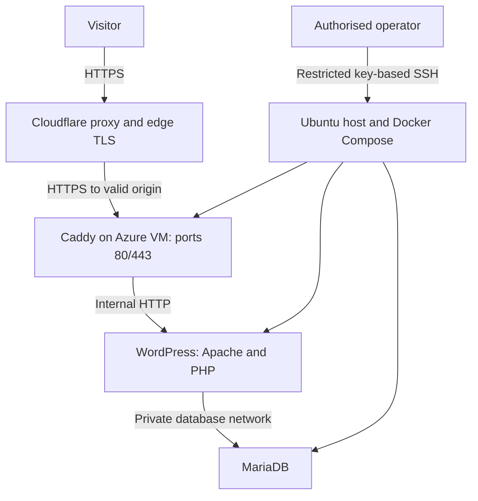

# Glowwise — VPS Deployment & Functional Website Setup

> **Current release — 10 October 2026:** Glowwise is live with 40 researched product families, 55 variants and seven founder-credited guides. All 40 families have photographs; 54/55 exact variants are pictured. The Minimalist Maleic Shampoo 100 ml pack remains a labelled fallback. Brand photographs have source attribution and disclosed demo-use status; reuse permission has not been independently verified. Published revision: `c55b1bd`. See the [release handoff](../Implementation/DEMO_MEDIA_RELEASE.md) and [current report](MILESTONE_I_SUBMISSION_REPORT.md). Research estimates and older evidence retain their original dates.

**Milestone 1 · Criterion 8 · 2 marks**  
**Prepared:** 10 October 2026, IST  
**Live website:** [glowwise.tech](https://glowwise.tech/)  
**Repository:** [aakash-kr-7/glowwise](https://github.com/aakash-kr-7/glowwise)  
**Status:** Azure VPS provisioned; Apache/PHP, MariaDB, Caddy and actual WordPress deployed. Existing SSH/runtime evidence reviewed; selected public responses freshly verified.

**Authority:** [Source of Truth](../../GLOWWISE_SOURCE_OF_TRUTH.md)  
**Supporting proof:** [Criterion evidence index](<../References/Milestone 1/08 VPS WordPress Setup/Evidence_Index.md>) · [SSH commands and actual output](<../References/Milestone 1/08 VPS WordPress Setup/SSH_Command_Evidence.md>)  
**Related criterion:** [Domain, DNS & Cloudflare](07_Domain_DNS_and_Cloudflare_Configuration.md)

## 1. Requirement and completed implementation

The handbook requires a cloud VPS, a configured LEMP/LAMP/OpenLiteSpeed stack with MySQL/MariaDB and PHP, SSL through Let's Encrypt / Certbot, a fresh functional WordPress installation, and SSH command evidence. The Excellent descriptor expects a functional deployment configured through SSH and verified with command logs.

Glowwise is deployed on **one Azure Linux virtual machine**, using a containerised **LAMP-style application stack**: Linux, Apache, MariaDB and PHP. Caddy handles HTTPS and reverse-proxy delivery in front of Apache. WordPress is the actual content-management application, with an authenticated editing interface, a custom theme and a separate persistent functionality plugin.

| Assessed requirement | Delivered result | Proof |
|---|---|---|
| Provision a cloud VPS | Azure `glowwise-vm`, Korea Central, Standard_B2ats_v2, Trusted Launch. | V01: actual Azure resource readback; source infrastructure template. |
| Configure web server, database and PHP | Apache 2.4.68, PHP 8.3.35 and MariaDB 11.4.13 in pinned containers on Ubuntu. | V02: actual SSH version/service output; V03: Compose and image locks. |
| Install SSL | Caddy's ACME client obtained a trusted Let's Encrypt origin certificate; Cloudflare uses Full (strict). | V06: trusted edge/origin TLS observations and Caddy configuration. |
| Fresh WordPress installation | WordPress core installed with WP-CLI on the new database, then configured and developed into Glowwise. | V04: installation script, actual initial core/configuration output and admin acceptance. |
| Functional website | Public pages, published product API, tools and native editing are evidenced. | V05/V07: dated application records and fresh public responses. |
| SSH terminal/command evidence | Actual version, policy, network, health and recovery logs, paired with collection commands. | V02 and the dedicated SSH command-evidence file. |

**Certificate-client distinction:** Let's Encrypt issuance is verified. **Certbot is not installed.** Caddy is the selected ACME client. If the instructor interprets the slash wording as mandating Certbot specifically, client acceptance remains an assessment clarification; the document does not conceal this distinction or claim instructor approval.

## 2. Actual Azure VPS configuration

| Item | Deployed configuration |
|---|---|
| Provider / subscription | Microsoft Azure / Azure for Students; Enabled and spending protection On in recorded readbacks. |
| Resource group / VM | `glowwise-dev-rg` / `glowwise-vm` |
| Region | Korea Central (`koreacentral`) |
| Size / architecture | `Standard_B2ats_v2`, x64, 2 vCPU and 1 GiB nominal RAM |
| Operating system | Ubuntu 24.04.5 LTS; Canonical Ubuntu 24.04 LTS image version `24.04.202609040` |
| OS disk | 32 GiB, Standard SSD LRS |
| Origin IPv4 | `20.249.61.80`, Standard regional static allocation |
| Boot security | Trusted Launch, Secure Boot and vTPM enabled |
| Resource controls | 2 GiB swap, bounded container memory and logs, health checks and restart policies |
| Development location | `/srv/glowwise/source` on the VM; local checkout holds source/docs/evidence. |

These are deployed facts from [V01's Azure readback](../References/Deployment/2026-10-09_Azure_Configuration.json), captured **9 October 2026, 11:04:15 UTC / 16:34:15 IST**, and its related SSH records. No new Azure provisioning was performed for this documentation pass.

### Provisioning decisions

The initial preferred regions/configurations were unavailable under the subscription. The implementation checked permitted regions and SKU restrictions before deploying B2ats v2 successfully in Korea Central. India would have been closer to the intended audience, but actual subscription availability constrained the choice. Cloudflare delivery and asset optimisation support this deployment; no guarantee of equal origin latency is made.

The first Standard-security attempt was rejected because of a subscription feature requirement. Trusted Launch succeeded using the existing named resources, avoiding a duplicate VM. Provisioning used the official Azure CLI/ARM workflow with normal account authentication. The tracked [foundation template](../../deploy/azure/foundation.json) preserves the infrastructure definition; private account identifiers and credentials are excluded from submission evidence.

No paid marketplace image, managed database, Bastion, NAT Gateway or load balancer was introduced. Azure is an appropriate cloud VM provider for this requirement; the handbook's named providers are examples rather than evidence that only those providers can be used. [Microsoft's VM overview](https://learn.microsoft.com/en-us/azure/virtual-machines/overview) explains the underlying infrastructure model.

## 3. Server stack and reproducibility



The Linux host runs Docker Compose. The official WordPress image contains the Apache/PHP application runtime; MariaDB supplies the compatible database. Caddy terminates origin TLS. This supplies the assessed LAMP components without installing a second conflicting web stack directly on the host.

| Component | Version actually logged | Responsibility |
|---|---|---|
| Docker Engine | 29.9.0 | Container runtime |
| Docker Compose | 5.6.0 | Reproducible service configuration |
| WordPress | 7.1.3 | Content management and application |
| Apache | 2.4.68 | WordPress HTTP application server |
| PHP | 8.3.35 | WordPress execution |
| MariaDB | 11.4.13 | Persistent application database |
| Caddy | 2.11.7 | Origin HTTPS, redirects and reverse proxy |
| WP-CLI | 2.12.0 | Installation, configuration and maintenance |

These versions come from the **9 October SSH output**, not a claim that they are currently the newest available releases. Exact application image digests and package pins are preserved in [Compose](../../deploy/stack/compose.yaml), [image locks](../../deploy/stack/images.lock.json) and [host package lock](../../deploy/host/docker-packages.lock). The selected PHP/MariaDB majors meet WordPress's published recommendations reviewed on 10 October: PHP 8.3+ and MariaDB 10.11+ or MySQL 8.0+, with HTTPS. [WordPress requirements](https://wordpress.org/about/requirements/).

### Networking, state and service controls

- Only Caddy maps application ports to the host: TCP **80 and 443**. Apache's internal port 80 and MariaDB's internal port 3306 are not publicly mapped.
- The database network is explicitly `internal: true`. WordPress connects using its dedicated database credentials, rather than the root account.
- Named volumes persist database data, WordPress files and Caddy certificate/configuration state. Theme and core-plugin source are mounted separately.
- Credentials are supplied from restricted files outside Git; the Compose source contains paths, not password values.
- Services use `restart: unless-stopped`, bounded logs and health checks. WordPress waits for the database health condition; Caddy waits for WordPress health. [Docker startup-order documentation](https://docs.docker.com/compose/how-tos/startup-order/).
- Memory limits are 256 MiB for MariaDB, 384 MiB for WordPress and 128 MiB for Caddy, with the WP-CLI tool separately bounded. Swap supports the small VM but is not a substitute for sufficient RAM under heavy traffic.

The deployment is a maintainable coursework/product installation, not a high-availability cluster or load-tested large-scale service.

## 4. SSH access and host security

The VM uses a non-root operator with key-based SSH and pinned host identity. The recorded NSG permits SSH only from the operator's current IPv4 `/32`, while allowing public HTTP/HTTPS. Root, password and keyboard-interactive SSH authentication are disabled.

Actual effective-policy output from the preserved SSH log:

```text
maxauthtries 3
permitrootlogin no
pubkeyauthentication yes
passwordauthentication no
kbdinteractiveauthentication no
```

The exact collection command is `sudo sshd -T`, filtered to relevant settings by [the evidence collector](../../deploy/scripts/collect-evidence.sh). The full sanitised output is linked in V02. Private keys, passwords, operator IP and account identifiers are not reproduced here.

The records also show OS security updates, unattended security updates without automatic reboot, restricted metadata access from containers and no pending reboot after recovery. Port observations from the authorised operator connected to **22/80/443**, while **3306/8080/2019** did not connect. This supports the intended boundary; it is not an exhaustive scan or proof that an unauthorised source was independently tested against SSH.

WordPress's in-dashboard file editor and automatic core updater are disabled in the tracked configuration. Updates therefore require the documented reviewed/pinned deployment workflow. OS updates and application updates are distinct responsibilities; neither is described as a universal automatic maintenance solution.

## 5. Fresh WordPress installation and its subsequent release

The fresh installation was created on the provisioned database with the official WordPress image and WP-CLI. [The installation script](../../deploy/scripts/install-wordpress.py) checks `core is-installed` first and refuses to replace an existing installation. It runs `core install` with private administrator details loaded from restricted files, skips notification email, sets the HTTPS site address and applies initial options.

### Initial installation evidence — 9 October

- Actual SSH output identifies WordPress core **7.1.3**, the HTTPS home address and `blog_public=0` during development.
- The installation used pretty permalinks, disabled avatars and closed default comments/pings.
- The protected installation returned authenticated HTTP 200; anonymous responses were initially 401/noindex. This was an intentional development gate.
- [Administrator acceptance](../References/Deployment/2026-10-09_WordPress_Admin.json), captured **10:58:31 UTC / 16:28:31 IST**, records a successful sign-in, detected dashboard, HTTP 200 and Secure/HttpOnly authentication cookies. No session or credential values were retained.

**“Fresh” describes how WordPress was deployed initially.** The completed application now contains genuine published content; it is not reinstalled or erased merely to reproduce the first stage for assessment.

### Completed functional application — 10 October

The same installation was developed into Glowwise using:

| Area | Working implementation |
|---|---|
| Presentation | Custom `glowwise` theme; PHP-rendered pages, responsive CSS and progressive JavaScript. |
| Durable functionality | Separate `glowwise-core` plugin; product structures, finder/comparison logic and private inbox. |
| Editing | Native WordPress Products, Posts and Pages with structured product/source fields. |
| Catalog/content | 40 published product families, 55 variants, seven researched guides and 16 native Pages in the editorial release records. The 36 core selections are retained. |
| Visitor tools | Search/filter, rules-based finder, compatible comparison, browser-local saves and exact purchase destinations. |
| Contact/corrections | Server-validated submission to a permission-restricted administrative inbox. |
| Supporting plugins | Yoast SEO Free, WP Super Cache and UpdraftPlus Free; dated versions in V05. |

The public preview lock was removed by owner instruction and the public launch later removed global development noindex. Native WordPress administration still requires authentication. The later [media release](../Implementation/DEMO_MEDIA_RELEASE.md) pictures all 40 product families and 54/55 variants through native WordPress attachments. Founder bylines are editable metadata; visible credits and schema agree. These working editorial features complement the server deployment. Brand-photo attribution and disclosed demo use do not establish reuse permission.

### Fresh public delivery observations

On **10 October 2026 at 05:47:14 UTC / 11:17:14 IST**, read-only requests recorded:

| Endpoint | Result |
|---|---|
| `/` | HTTP 200, public HTML |
| `/explore/` | HTTP 200, catalog HTML |
| `/guides/shampoo-for-dry-frizzy-hair/` | HTTP 200, guide HTML |
| `/wp-json/glowwise/v1/products` | HTTP 200, JSON; reported total **40** |
| `/wp-admin/` | HTTP 302 to native HTTPS WordPress login |

See [V07 — public WordPress readback](<../References/Milestone 1/08 VPS WordPress Setup/2026-10-10_Public_WordPress_Readback.json>). These requests confirm selected delivery and the login boundary. They do not rerun browser journeys, administrator authentication, SSH or the entire application suite.

The separately dated editorial records include 197 content assertions, 821 broader HTTP assertions and actual desktop/mobile guide and tool journeys. These historical results support functionality and are attributed to [the editorial handoff](../Implementation/EDITORIAL_RELEASE_HANDOFF.md), rather than described as newly executed checks.

## 6. Let's Encrypt HTTPS installation

Caddy explicitly selects:

```text
acme_ca https://acme-v02.api.letsencrypt.org/directory
```

Its persisted certificate volume supports certificate reuse and automatic renewal. HTTP and `www` requests redirect to `https://glowwise.tech`, and forwarded HTTPS information is handled in the WordPress configuration so application URLs remain consistent.

The [10 October trusted TLS record](<../References/Milestone 1/07 Domain DNS Cloudflare/2026-10-10_HTTP_TLS_Refresh.json>) independently validates the origin connection with apex SNI and normal system trust. Observed origin TLS is **1.3**, issuer **Let's Encrypt / YE1**, SAN **`glowwise.tech`**, expiry **7 January 2027 at 03:07:36 UTC**. The Cloudflare edge certificate is separately validated; it is not used as a substitute for origin proof.

Caddy's own ACME client issued the certificate. **No Certbot command, Certbot installation or forced renewal is claimed.** Automatic renewal is configured, but no elapsed renewal cycle has been observed. The origin must be running and reachable for renewal. [Caddy automatic HTTPS documentation](https://caddyserver.com/docs/automatic-https) supports this mechanism; [the decision register](../Implementation/DECISIONS.md) preserves the certificate-client choice and assessment clarification.

## 7. SSH terminal logs and command evidence

The supporting [SSH command-evidence file](<../References/Milestone 1/08 VPS WordPress Setup/SSH_Command_Evidence.md>) pairs real commands with selected existing output and links the complete logs.

Core inspection commands from the actual collector include:

```bash
cd /srv/glowwise/source/deploy/stack
sudo docker compose exec -T wordpress php -v
sudo docker compose exec -T wordpress apache2 -v
sudo docker compose exec -T database mariadb --version
sudo docker compose exec -T caddy caddy version
sudo docker compose run --rm -T wpcli core version
sudo docker compose run --rm -T wpcli core is-installed
sudo docker compose ps
sudo docker network inspect glowwise_database --format 'Database network internal={{.Internal}}'
```

Actual selected output, captured **9 October at 10:50:18–10:50:33 UTC**:

```text
PHP 8.3.35 (cli)
Server version: Apache/2.4.68 (Debian)
mariadb from 11.4.13-MariaDB
v2.11.7
WP-CLI 2.12.0
7.1.3
Database network internal=true
```

These are shortened excerpts from real output, not simulated terminal sessions. The complete log preserves version context and service health. The command listing is evidence of the documented collection method, not an instruction to reinstall or mutate production. No new SSH session was opened during this documentation pass.

## 8. Persistence, recovery and operating limits

Existing records show all three services healthy after host reboots. A later configuration log confirms **`No_pending_reboot`**. Persistent state survived; the restart/health configuration is therefore supported by observed recovery as well as source configuration.

Initial infrastructure backup validation restored files and SQL into isolation, matched selected hashes/table counts and retained the development indexing option without replacing the live database. Later UpdraftPlus verification restored **40 products, seven guides and 16 Pages** with the production indexing decision and matching source/content metadata. Restricted off-VM checksums were also verified. Raw backups and secrets remain outside Git.

This is isolated recovery evidence, not a claim of a new-VM failover, freshly restored administrator-browser sign-in or publicly shared coursework backup. Those broader deliverables retain their own limits.

The owner's **US$10 total** Azure allowance applies across the project's lifetime. Budget alerts do not provide a custom hard cap. A conservative exposure/traffic guard and finite operating lease remain configured. Current handoff records place lease expiry at **16 October 2026, 09:31:49 IST**; the initial midnight shutdown was later disabled for the finite launch lease. Historical Stage 2 shutdown settings are not presented as the current launch policy. Deallocation can retain disk/IP costs. See [operations](../Deployment/OPERATIONS.md) and [the cost ledger](../Deployment/COST_LEDGER.md).

Confirm the VM is available for assessment within this lifecycle. This document does not extend the lease, change shutdown controls or promise permanent free hosting.

## 9. Conclusion and evidence boundaries

Glowwise's Azure VM hosts a real, persistent WordPress application with Linux, Apache, PHP and MariaDB, secured origin HTTPS through Let's Encrypt, restricted SSH administration and reproducible configuration. Actual SSH logs establish the runtime versions, private database network and service health; administrator acceptance and fresh public delivery observations establish the working installation.

The criterion's technical work is implemented and evidenced. Remaining assessment interpretation concerns the specific ACME client, not an absent certificate: Caddy is used and Certbot is not claimed. No marks, universal security certification or indefinite availability are self-declared.

## 10. References

Assessment authority: `Reference/Mini-Project Handbook.docx`, Milestone I criterion 8 and its Excellent descriptor. Original stage and current editorial records retain their capture dates in the evidence index.

Official technical references reviewed **10 October 2026**:

1. [Microsoft — Azure virtual machines overview](https://learn.microsoft.com/en-us/azure/virtual-machines/overview).
2. [WordPress — Hosting requirements](https://wordpress.org/about/requirements/).
3. [Docker — Compose startup and shutdown order](https://docs.docker.com/compose/how-tos/startup-order/).
4. [Caddy — Automatic HTTPS and certificate management](https://caddyserver.com/docs/automatic-https).

These references explain the implementation choices. The [criterion evidence index](<../References/Milestone 1/08 VPS WordPress Setup/Evidence_Index.md>) links the actual project records that substantiate them.

## Current content and media verification — 10 October

The published release is revision `c55b1bdd181d30eaaa1dfae73e8494eef1b5d4d6`. The media/content acceptance comprises 80 new live checks, 197 retained content checks and nine native media/security checks: **286 passing checks** across their stated scopes. This is distinct from the dated SSH installation evidence above. Seven founder-credited articles remain substantial and source-linked; actual mobile save/compare behaviour is recorded in the [browser evidence](../References/Deployment/Demo_Media/browser-checks.json). The [latest private backup](../References/Deployment/Demo_Media/backup.json) and [source comparison](../References/Deployment/Demo_Media/backup-source.json) retain the live content and custom code. No new SSH, performance lab or full device matrix is claimed by this document update.
